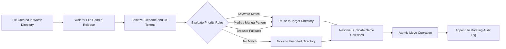

# greenshot-sorter

An automated background file-system watcher that monitors screenshot output directories, parses naming patterns, and routes image files into categorized target directories.

## Overview

Greenshot Sorter is a lightweight filesystem automation daemon for Windows environments. It continuously listens for newly captured Greenshot screenshots (`.png`, `.jpg`, `.jpeg`, `.bmp`, `.webp`), parses filename metadata using regex and rule-based priority routing, and sorts incoming captures into project-, media-, or browser-specific subdirectories without human intervention.

## Architecture and Pipeline

The service utilizes an event-driven architecture based on native OS file notifications, combined with a lock-verification step to prevent race conditions during write completion.



- Ingestion: `watchdog.observers.Observer` captures `FileCreatedEvent` notifications in the watch directory.
- Concurrency and Lock Handling: The worker polls the target file handle via non-blocking read access until Windows completes the write buffer release.
- Transformation and Parsing: Rule engines sanitize OS-restricted characters (`< > : " / \ | ? *`), normalize whitespace, strip browser/group noise, and extract canonical directory names.
- Routing Engine:
  - Priority 1: Direct keyword mapping (`CUSTOM_KEYWORDS`).
  - Priority 2: Serialized media and manga chapter patterns with scanlation suffix truncation.
  - Priority 3: Media player window captures (e.g., PotPlayer releases).
  - Priority 4: Web browser signatures routed to a dedicated browser screenshots container.
  - Fallback: Unmatched captures route to the `Unsorted` directory.
- Storage: Moves files atomically using collision detection (`_1`, `_2` suffix increments) and writes audit entries via `RotatingFileHandler`.

## Tech Stack

| Component | Technology | Description |
| :--- | :--- | :--- |
| Runtime | Python 3.10+ | Primary script execution environment |
| Event Watcher | watchdog (>= 3.0.0) | Cross-platform filesystem event monitoring |
| Logging | logging.handlers.RotatingFileHandler | UTF-8 rotating audit logs (5 MB cap, 3 backups) |
| System Layer | Windows Shell / VBScript | Headless daemon startup via `pythonw.exe` |

## Project Structure

```text
greenshot_sorter/
├── .env.example          # Sample environment configuration
├── .gitignore            # Git exclusion rules
├── README.md             # Technical documentation
├── requirements.txt      # Python package manifest
├── Run_Dashboard.vbs     # Silent background execution script (Windows)
├── sorter.py             # Core file monitoring and routing daemon
└── start_sorter.bat      # CLI batch launcher
```

## Setup and Prerequisites

### Prerequisites
- Python 3.10 or higher
- Windows 10/11 operating system

### Installation

1. Clone or navigate to the project directory:
   ```bash
   cd c:/Tools/greenshot_sorter
   ```

2. Create and activate an isolated virtual environment:
   ```bash
   python -m venv .venv
   .venv\Scripts\activate
   ```

3. Install production dependencies:
   ```bash
   pip install -r requirements.txt
   ```

4. Configure environment variables:
   ```bash
   copy .env.example .env
   ```

Adjust the paths inside `.env` or set system variables if your screenshot directory differs from the default `GREENSHOT DB`.

## Usage Examples

### Foreground Execution (Console Mode)
To run the watcher in the foreground with standard output:
```bash
python sorter.py
```

### Headless Execution (Background Daemon)
To execute silently in the background without keeping a terminal window open:
```bash
wscript.exe Run_Dashboard.vbs
```
Alternatively, trigger the batch wrapper:
```bash
start_sorter.bat
```

### Configuration Environment Variables

| Variable | Default Value | Description |
| :--- | :--- | :--- |
| `GREENSHOT_SOURCE_DIR` | `../GREENSHOT DB` | Root directory monitored for incoming screenshots |
| `GREENSHOT_UNSORTED_DIR`| `$GREENSHOT_SOURCE_DIR/Unsorted` | Destination for files matching no priority rules |
| `GREENSHOT_LOG_FILE` | `greenshot_sorter.log` | Destination path for rotating execution logs |

## Notes and Constraints

- Windows Lock Latency: If an external tool writes a large screenshot slowly, the script polls the file lock for up to 5.0 seconds before skipping to avoid hanging worker threads.
- Startup Re-indexing: When `sorter.py` initializes, it runs a synchronous scan across the root watch folder to process any backlog images created while the process was offline.
- Case Insensitivity: Filename matching rules are evaluated case-insensitively, but preserved folder names retain original casing when dynamically generated.
